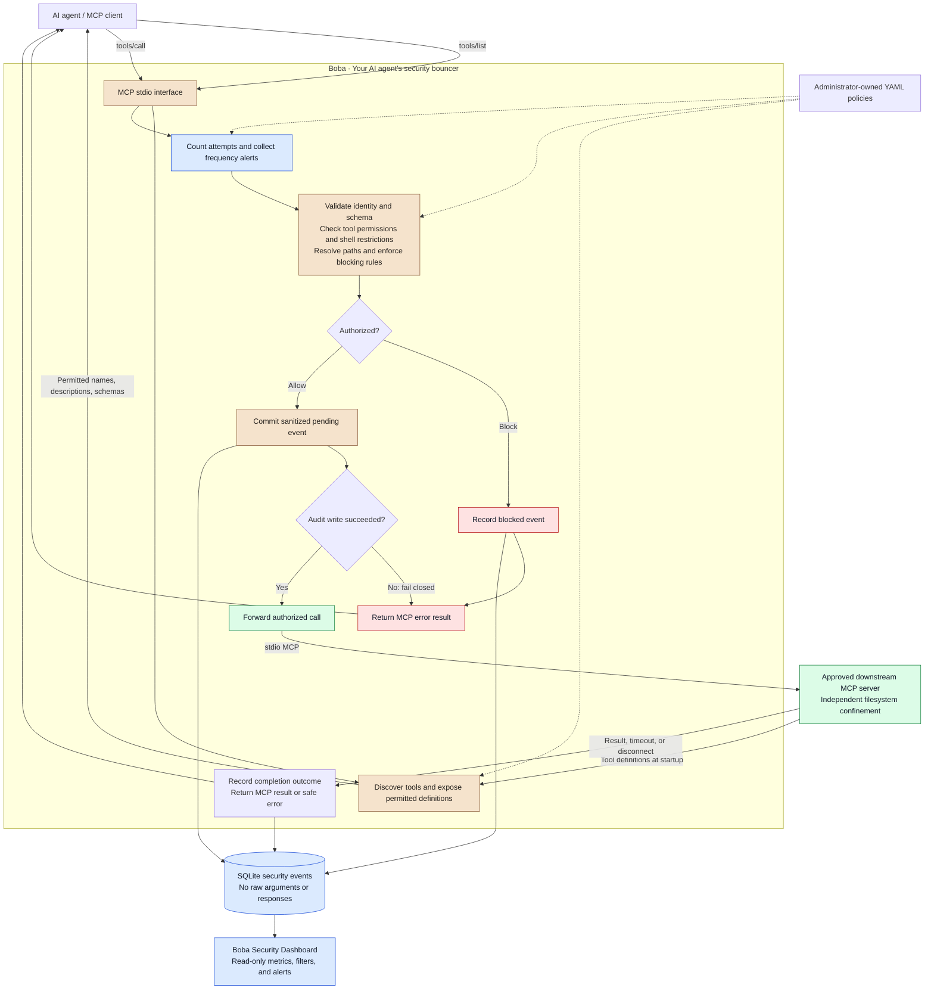

<div align="center">
  
  <h1>Boba</h1>
  <p><strong>Your AI agent's security bouncer.</strong></p>
  <p>Boba checks the tools. You control the access.</p>
  <p>
    
    
    
    <a href="LICENSE"></a>
  </p>
  <p>
    <a href="#install">Get started</a> ·
    <a href="#demonstrate-enforcement">Try the demo</a> ·
    <a href="#dashboard">Dashboard</a> ·
    <a href="docs/threat-model.md">Threat model</a>
  </p>
</div>

---

Boba is a local, open-source MCP runtime security gateway for security engineers,
SOC analysts, AI security researchers, and Python developers. An agent connects to
Boba instead of directly to its MCP server. Boba validates and authorizes each
tool call **before** forwarding it.

| Check the request | Control execution | See what happened |
| --- | --- | --- |
| Validate tools, arguments, and filesystem paths. | Block unauthorized calls before they execute. | Inspect sanitized events and alerts in the local dashboard. |

## Why Boba?

Giving an agent tools can also give it access to files and operations it should
not use. Activity logging alone cannot prevent those operations. Boba combines
default-deny permissions, deterministic security checks, and a payload-free audit
trail. A denied call never reaches the downstream tool handler.

## Architecture



GitHub renders this Mermaid.js diagram directly in the README. Alerts are monitoring
findings, never execution permissions. A denied call has no path to the downstream
server, and an allowed call requires a durable audit record before forwarding.

See [architecture](docs/architecture.md) and [threat model](docs/threat-model.md).

## Features and stack

- Official **MCP Python SDK v2** on both stdio connections; preserved approved tool definitions.
- **Pydantic + PyYAML** strict policy/configuration validation; default deny, explicit blocking rules.
- **JSON Schema** argument validation, canonical filesystem containment, protected-path checks.
- Shell execution tools disabled; no dangerous command-string guessing.
- Bounded sliding-window alert detection; alerts never grant execution permissions.
- **SQLite** metadata-only events with pre-execution durability and completion outcomes.
- Optional **Streamlit** dashboard with filters, real metrics, rule counts, and activity charts.
- **pytest** unit tests and real subprocess MCP integration tests, including execution counters.

Version: **0.1.0**. Python **3.11+**; the included demo requires **macOS or Linux**
for descriptor-relative, no-follow filesystem operations. Local verification used
Python 3.14 and MCP 2.3.0. This is a bounded MVP, not a process sandbox.

## Install

From the repository root:

```bash
python3.14 -m venv .venv  # or another supported Python 3.11+ interpreter
source .venv/bin/activate
python -m pip install -e '.[dev,dashboard]'
```

The core package is `boba-mcp`; its Python import is `boba`. Dashboard dependencies
are optional: `pip install -e .` installs only the gateway.

## Milestone 1: direct MCP demo

```bash
python demo/test_client.py --direct
python demo/test_client.py --direct --path .aws/credentials
```

The client starts a real stdio MCP subprocess, discovers tools, and reads a file.
The second command returns **fake** credentials to demonstrate the policy-permissive
baseline. The demo remains sandbox-confined even without Boba.

You can also run the server directly for an MCP host to attach to:

```bash
python demo/vulnerable_server.py
```

A stdio server waits for MCP messages on stdin; it is not an interactive shell or
an HTTP service. Normally the client or gateway launches it automatically.

## Configuration

`config/boba.yaml` selects one administrator-approved executable, server ID, policy,
database, configured agent label, and timeout. `@python` means the same interpreter
running Boba. Configuration paths and downstream `cwd` resolve relative to the
configuration file. Approved roots resolve relative to the **policy** file.

```yaml
version: 1
defaults:
  action: block
servers:
  demo-filesystem:
    allowed_tools: [read_file, list_directory]
    approved_roots: [../demo/safe_files]
    path_arguments:
      read_file: [path]
      list_directory: [path]
rules:
  - id: SEC-001
    name: Protected credentials
    action: block
    paths: ['**/.aws/**', '**/.ssh/**', '**/.env*', '**/secrets/**']
  - id: SEC-003
    name: Excessive tool usage
    action: alert
    threshold: 30
    window_seconds: 60
```

The policy format is **Boba-specific**, not part of MCP. Each approved tool must
have explicit top-level path argument bindings. An empty list explicitly declares
that a reviewed tool has no filesystem paths. Never grant that declaration to a
tool that can interpret filenames, code, URLs, or embedded commands without
understanding its behavior. See [exact policy semantics](docs/policies.md).

Change YAML and **restart Boba** to apply it. For example, add a blocking rule for
`tools: [read_file]`; it disappears from discovery and direct calls are denied.
Invalid configuration stops startup. There is no permissive fallback or hot reload.

## Run Boba

```bash
boba --config config/boba.yaml
```

As with the demo, an MCP host normally launches this stdio process. Example host
configuration (replace the absolute paths):

```json
{
  "mcpServers": {
    "boba": {
      "command": "/absolute/path/boba-mcp/.venv/bin/boba",
      "args": ["--config", "/absolute/path/boba-mcp/config/boba.yaml"]
    }
  }
}
```

Configure the agent to use Boba rather than the direct demo server. No API keys,
OAuth, network service, or `.env` loading is required.

## Demonstrate enforcement

```bash
python demo/test_client.py
python demo/test_client.py --path .aws/credentials
python demo/attack_scenarios.py
```

The protected request returns an MCP `CallToolResult` with `isError: true` and
`Boba: Protected credential path`. The attack runner asserts and prints:

```text
Scenario 1: BLOCK; downstream executions: 0
...
Scenario 8: BLOCK; downstream executions: 0
Safe read: ALLOW; downstream executions: 1
```

It also produces frequency alerts. These are real events in `events.db`; no
fictional dashboard data is preloaded. The integration suite additionally verifies
symlink escapes and compares every denied call against the handler-entry counter.

## Dashboard

```bash
streamlit run src/boba/dashboard/app.py --server.address 127.0.0.1 -- --config config/boba.yaml
```

Open the local URL printed by Streamlit. Click **Refresh** after making calls.
The dashboard uses Boba's sunglasses mascot and a milk-tea-inspired cream,
caramel, and dark-ink theme, configured in `.streamlit/config.toml`.
Filter by severity, tool, or decision. Metrics reflect the filters; recent and
blocked tables display up to 500 rows. “Allowed” means authorization succeeded;
`outcome` distinguishes successful execution, downstream error, cancellation, or
an unfinished (`pending`) call. Alerts are counted as findings, not extra calls.

## Tests

```bash
python -m pytest -q
python -m pytest tests/test_integration.py -q
python -m pip check
```

Tests use disposable files and fake credentials. They never execute destructive
shell commands. See [verification and release checklist](docs/development-roadmap.md).

## Security limitations

- **Only traffic routed through Boba is protected.** Direct tools, other MCP
  servers, and unrelated network access bypass it. `agent_id` is a configured
  audit label, not an authenticated identity.
- Run downstream processes with restricted OS permissions. Boba does not isolate
  them or prevent malicious behavior inside an allowed tool.
- Gateway path checks have filesystem TOCTOU races. Canonicalizing and forwarding
  absolute paths reduces ambiguity but cannot lock an external server's file
  access. The demo independently uses descriptor-relative no-follow operations;
  arbitrary downstream servers need their own filesystem enforcement.
- No response/prompt-injection inspection, schema pinning, remote authentication,
  automatic retries, or cross-process rate coordination in v0.1.
- A timed-out/cancelled allowed call may already have executed. It is not reported
  as blocked or automatically retried. Pending audit records can survive a crash.
- SQLite metadata is not tamper-proof. Protect configuration and database files,
  keep the dashboard local, and manage retention. Raw arguments, tool outputs,
  exception payloads, and unapproved tool names are not stored.

## Roadmap

| Release | Focus |
| --- | --- |
| v0.1 | Local stdio enforcement, deterministic policies, auditing, dashboard |
| v0.2 | Tool schema pinning and description/integrity change detection |
| v0.3 | Human approval workflows |
| v0.4 | Authenticated remote Streamable HTTP support |
| v0.5 | Response inspection and richer threat detection |
| v1.0 | Multiple servers, stronger isolation, SIEM export, centralized policies |

Licensed under [MIT](LICENSE).
