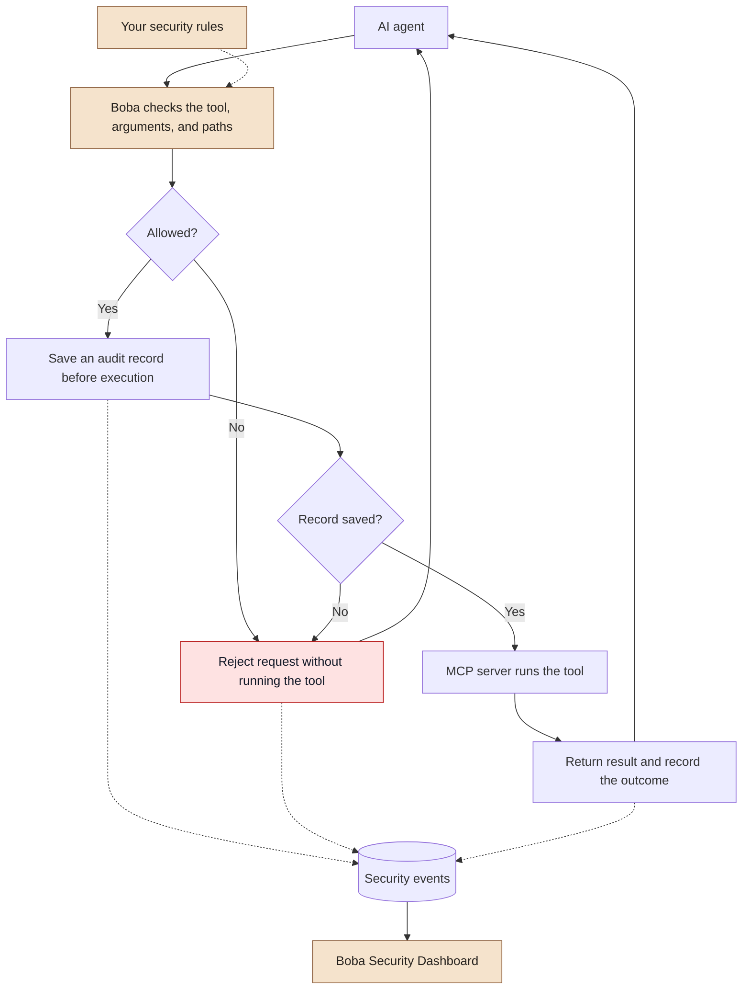

<div align="center">
  
  <h1>Boba</h1>
  <p><strong>Your AI agent's security bouncer.</strong></p>
  <p>Boba checks the tools. You control the access.</p>
  <p>
    
    
    
    <a href="LICENSE"></a>
  </p>
  <p>
    <a href="#install">Get started</a> ·
    <a href="#try-it-out">Try the demo</a> ·
    <a href="#dashboard">Dashboard</a> ·
    <a href="docs/threat-model.md">Threat model</a>
  </p>
</div>

---

Boba helps you control what your AI agent is allowed to do with its tools.

It sits between the agent and an MCP server, checking each request **before the
tool runs**. Reading an approved document? Let it through. Trying to read credentials
or run an unauthorized command? Block it and record why.

**New to MCP?** The Model Context Protocol lets AI applications use tools provided
by other programs, such as a tool that reads files. Boba adds a checkpoint between
the AI application and those tools.

## What can it do today?

- **Control tool access.** Only tools you explicitly approve can run.
- **Protect files.** Block credential reads, attempts to leave approved folders,
  and symbolic links that point outside them.
- **Reject invalid requests.** Check that each tool receives the arguments it expects.
- **Flag unusual activity.** Alert when an agent makes too many calls in a short time.
- **Show what happened.** View allowed calls, blocked attempts, and alerts in a local dashboard.

Boba v0.1.0 supports **one local MCP server**. Everything runs on your machine;
no cloud account or API key is needed.

## Install

You need **Python 3.11 or newer** and **macOS or Linux** for the included demo.
Local testing used Python 3.14.

Clone the repository, then install Boba and its dashboard:

```bash
git clone https://github.com/ccfreck/boba.git
cd boba
python3 -m venv .venv
source .venv/bin/activate
python -m pip install '.[dashboard]'
```

Already have the repository? Start with `python3 -m venv .venv` from its folder.
Run the commands below from that same folder, with the virtual environment active.

## Try it out

The demo includes ordinary documents and **fake credentials**. Each command starts
Boba and the demo MCP server for you—there is no separate server setup.

### 1. Read an allowed file

```bash
python demo/test_client.py
```

You should see the available tools and a greeting from `hello.txt`.

### 2. Try reading a protected file

```bash
python demo/test_client.py --path .aws/credentials
```

This time, Boba returns an error containing:

```text
Boba: Protected credential path
```

The file-reading tool never runs for that request.

### 3. Run the attack demo

```bash
python demo/attack_scenarios.py
```

This checks eight blocked scenarios, then makes allowed calls to trigger frequency
alerts. An execution counter proves the blocked requests did not reach the tools:

```text
Scenario 1: BLOCK; downstream executions: 0
...
Scenario 8: BLOCK; downstream executions: 0
Safe read: ALLOW; downstream executions: 1
```

Want to compare access without Boba? Run
`python demo/test_client.py --direct --path .aws/credentials`.
The demo returns the fake credentials directly, while still restricting access to
its sandbox folder.

## Dashboard

```bash
streamlit run src/boba/dashboard/app.py --server.address 127.0.0.1 -- --config config/boba.yaml
```

Open **http://localhost:8501** (or the URL Streamlit prints). Press **Ctrl+C** in
the terminal to stop the dashboard.

The dashboard shows:

- Total calls, allowed requests, blocked requests, and security alerts.
- Recent events with the tool, decision, reason, and execution outcome.
- A separate view of blocked requests.
- Charts of suspicious activity, popular tools, and triggered rules.
- Your configured security policies.

Filter by severity, tool, or decision, and click **Refresh** after making new calls.
All data comes from real events saved in `events.db`. A fresh installation starts
empty. Raw arguments, credentials, and file contents are not stored in the audit log.

**“Allowed” means Boba granted permission, not that the tool succeeded.** Check the
execution outcome for errors, timeouts, or unfinished requests.

## How it works



Boba uses fixed rules rather than an AI model to make security decisions. A block
always wins over permission, and an alert never gives a request permission to run.
If Boba cannot save the initial audit record, it does not forward the request.

For the implementation details, see the [architecture guide](docs/architecture.md).

## Configuration

There are two files to know:

| File | What you control |
| --- | --- |
| [`config/boba.yaml`](config/boba.yaml) | Which MCP server Boba starts, where events are stored, and how long calls may take. |
| [`config/policies.yaml`](config/policies.yaml) | Which tools and folders are allowed, what gets blocked, and when alerts fire. |

The included policy allows `read_file` and `list_directory` inside
`demo/safe_files/`. Everything else is denied unless explicitly approved.

Here is an example policy:

```yaml
version: 1
defaults:
  action: block
servers:
  demo-filesystem:
    allowed_tools: [read_file, list_directory]
    approved_roots: [../demo/safe_files]
    path_arguments:
      read_file: [path]
      list_directory: [path]
rules:
  - id: SEC-001
    name: Protected credentials
    action: block
    paths: ['**/.aws/**', '**/.ssh/**', '**/.env*', '**/secrets/**']
  - id: SEC-003
    name: Excessive tool usage
    action: alert
    threshold: 30
    window_seconds: 60
```

In plain English, this means:

- Only the two listed tools can run, and their `path` arguments must stay in the approved folder.
- Credential paths are blocked. Boba also has built-in protections for `.aws`,
  `.ssh`, `.env*`, and `secrets`, so removing the example rule does not unlock them.
- Shell execution tools are disabled in this release.
- More than 30 attempts in 60 seconds produces an alert. That alert alone does not block a call.

**Restart Boba after changing a policy.** Invalid configuration prevents startup.
The demo client starts a new gateway each time, so its next run picks up your changes.

Folder paths in the policy are relative to the policy file. `path_arguments` tells
Boba which tool inputs represent file paths. See the [policy guide](docs/policies.md)
for exact matching rules and how to configure other tools.

## Connect your AI client

Configure your MCP-compatible AI application to launch Boba instead of connecting
directly to the tool server. For clients that use an `mcpServers` configuration,
the entry looks like this (replace the paths with your own):

```json
{
  "mcpServers": {
    "boba": {
      "command": "/absolute/path/boba/.venv/bin/boba",
      "args": ["--config", "/absolute/path/boba/config/boba.yaml"]
    }
  }
}
```

Boba communicates through **stdio**: the AI client exchanges messages with the
Boba process through its input and output streams. It does not use a web address.

You can start it manually with `boba --config config/boba.yaml`, but it will wait
for MCP messages rather than display a page. Likewise, `python demo/vulnerable_server.py`
starts the standalone demo server. Normally the client starts these processes for you.

## Tests

```bash
python -m pip install '.[dev,dashboard]'
python -m pytest -q
python -m pip check
```

The implementation was verified with **47 passing tests**, including real MCP
connections. One integration test sends ten denied requests and checks that none
reach the downstream tool, then confirms an allowed read succeeds.

Tests use temporary files and fake credentials. See the
[verification record](docs/development-roadmap.md) for results and remaining release checks.

## What Boba does not protect

- **Requests that bypass it.** Direct tools, other MCP servers, and unrelated
  network connections are outside Boba's control.
- **The server process itself.** An allowed tool could still be buggy or malicious.
  Run it with restricted operating-system permissions; Boba is not a sandbox.
- **Every possible filesystem change.** A file or symlink can change between
  Boba checking it and another server opening it. Servers need their own file-access
  restrictions; the demo implements these independently.
- **Malicious tool responses or prompt injection.** Response inspection is future work.
- **Undoing an allowed operation.** A call that times out or is cancelled may
  already have run. Boba records the outcome but cannot roll it back.

Keep the dashboard local and protect the policy and database files. Audit records
are not tamper-proof, and the configured agent name is a label—not proof of identity.
Read the [threat model](docs/threat-model.md) for the full security boundary.

## Built with

Python, the official MCP Python SDK v2, Pydantic, PyYAML, JSON Schema validation,
SQLite, Streamlit, and pytest. No external database or cloud service is required.

## Roadmap

| Release | Focus |
| --- | --- |
| v0.1 | Local stdio enforcement, deterministic policies, auditing, dashboard |
| v0.2 | Tool schema pinning and description/integrity change detection |
| v0.3 | Human approval workflows |
| v0.4 | Authenticated remote Streamable HTTP support |
| v0.5 | Response inspection and richer threat detection |
| v1.0 | Multiple servers, stronger isolation, SIEM export, centralized policies |

Licensed under [MIT](LICENSE).
