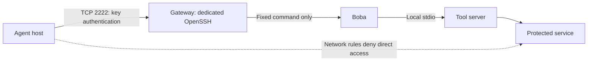

# Milestone One: MCP over a dedicated SSH endpoint

Implementation started; deployment and network acceptance are pending. No agent
container or sandbox is used. OpenSSH carries MCP's existing newline-delimited
stdio messages over an encrypted, authenticated connection.

**Starting on one device:** follow the [local test guide](../../docs/milestone-one-local.md)
first. It needs no gateway provisioning or firewall changes. The instructions
below describe the subsequent deployment on a separate gateway.



## Transport decision

Use a dedicated OpenSSH daemon on port 2222 with a single authorized client key.
Every permitted session starts a fixed Boba command. No arbitrary command,
interactive shell, SFTP, TCP forwarding, Unix socket forwarding, SSH agent
forwarding, or tunnel is permitted. Administrative SSH remains separate on port
22 and inaccessible from the agent network.

`boba-remote` provides a stdio interface to existing MCP clients. It pins the
server's host key, disables ambient SSH configuration and password prompts,
preserves the protocol byte streams, and never retries a failed operation or
falls back to a direct service connection. This does not add Streamable HTTP.

The key establishes one deployment identity; Boba's configured `agent_id` remains
an operator label. Use this only for the single-client milestone. Each session
starts a new gateway process; the forced-command launcher uses a lock to permit
only one active session. Frequency counters reset on reconnect. The durable audit
database persists across sessions.

## Gateway prerequisites

A Linux gateway with Python 3.11+, OpenSSH server, systemd, and util-linux `flock`.
The operator needs a separate administrative access path and control of the
external firewall or destination network policy. Select the gateway address and
protected service before applying rules. The supplied configuration binds only
to loopback until the operator sets the intended gateway interface.

Install the project into `/opt/boba/.venv` using `pip install .`. Create a dedicated
`boba-mcp` service account with `/bin/sh` as its shell and no sudo or administrative
group membership. The account must be permitted to authenticate by public key
under the host's account policy; password login is disabled in this daemon.

Deploy these files as administrator-owned, not writable by `boba-mcp`:

| Source | Destination |
| --- | --- |
| `sshd_config` | `/etc/boba/sshd_config` |
| `boba-session` | `/usr/local/libexec/boba-session` (0755, LF line endings) |
| `boba-sshd.service` | `/etc/systemd/system/boba-sshd.service` |
| Your Boba settings and policy | `/etc/boba/boba.yaml` and `/etc/boba/policies.yaml` |

The installed Python environment and source must also be administrator-owned.
Keep `/etc/boba` non-writable by the service account. Make `/var/lib/boba` writable
only by `boba-mcp`; configure the SQLite database there. The approved data root
must be separate from the database and any credentials. Set `agent_id` to the
single client label and use absolute paths in the gateway configuration.

Generate a dedicated Ed25519 SSH host key at `/etc/boba/ssh_host_ed25519_key` using
`ssh-keygen`, keeping its private half root-readable only. Put the client's public
key in root-owned `/etc/boba/authorized_keys`. Prefix the key with `restrict` and,
once known, a `from="AGENT_ADDRESS"` restriction. Never put private client keys or
downstream credentials in this repository. Do not copy an agent's entire SSH config.

The launcher starts Boba with a clean environment. Downstream credentials, if
needed, must be provided through a deliberate server-side mechanism; arbitrary
client environment forwarding is disabled.

Before starting, validate as administrator:

```sh
/usr/sbin/sshd -t -f /etc/boba/sshd_config
/usr/sbin/sshd -T -f /etc/boba/sshd_config
```

Confirm effective `forcecommand`, `disableforwarding yes`, `permittty no`,
`permituserrc no`, and `authenticationmethods publickey`. Confirm the listener
address and authorized-key file. Create the distribution's sshd runtime directory
if required. Apply and verify external network restrictions before exposure, then
use `systemctl daemon-reload` and `systemctl start boba-sshd`. Stop the endpoint with
`systemctl stop boba-sshd`; its control group includes active Boba sessions.
Enable startup only after acceptance tests pass.

## Agent connection

Install Boba and the OpenSSH client on the agent host. Create a dedicated client
key and register its public half on the gateway. Obtain the gateway's host public
key through the trusted operator channel. An unverified `ssh-keyscan` result is
not a trust anchor.

The pinned known-hosts entry for the non-default port has this form:

```text
[gateway.example.test]:2222 ssh-ed25519 VERIFIED_GATEWAY_PUBLIC_KEY
```

Copy `config/remote.example.yaml` to a private client configuration and set its
host, key file, and known-hosts file. Paths resolve relative to that configuration.
Keep the client private key readable only by the account running the agent.
The agent can use this key to access Boba, but it must not receive downstream or
network administration credentials. Local key isolation is outside this milestone.

Configure the AI application's stdio MCP connection:

```json
{
  "mcpServers": {
    "boba": {
      "command": "boba-remote",
      "args": ["--config", "/absolute/path/to/remote.yaml"]
    }
  }
}
```

Use the absolute executable path if the application cannot locate `boba-remote`.
This connects to the remote gateway; it does not start a local Boba fallback.

## Firewall configuration

`firewall-rules.csv` is a provider-neutral rule specification, not an executable
firewall configuration. Replace every placeholder after selecting the topology.
Use an enforcement point outside the agent host and restrict the protected
destination to the gateway source. Some platforms express DENY as absence of an
allow rule; account for all existing rules before translating the table.

The table is not a complete host firewall policy: preserve required routing,
stateful return traffic, DNS, and operator management access. Inventory IPv4,
IPv6, VPNs, proxies, same-subnet paths, shared NAT addresses, and alternate service
endpoints. The agent and gateway must be distinguishable at enforcement; a shared
public source IP is insufficient for a destination allowlist. Do not change the
current machine's firewall or apply placeholder rules.

## Deployment acceptance

Record the topology, effective daemon configuration, network rules, test time,
and results without payloads or private keys. Test from the actual agent host:

1. Pinned host key plus authorized client key: MCP discovery and an approved call
   succeed. Check the Boba audit outcome and downstream execution count.
2. Unknown/wrong host key or unauthorized client key: authentication fails before
   any tool execution. No automatic trust prompt or fallback is permitted.
3. With the valid agent key, attempt `ssh ... id`, SFTP, a PTY, and `ssh ... -W
   PROTECTED_HOST:SERVICE_PORT`. Commands/subsystems must fail; PTY and forwarding
   must be refused. A forced command alone does not prohibit forwarding.
4. A Boba-denied call leaves the downstream execution counter unchanged. A failed
   initial audit write also prevents execution.
5. Direct protected-service connections fail from the agent (including terminal
   child processes). Independently confirm service health and connectivity from
   the gateway at the same time. A timeout alone does not prove firewall enforcement.
6. Agent access to gateway administration and firewall management fails.
7. Stop the dedicated daemon: new calls fail, with direct access still denied.
   Restart the daemon and hosts; repeat the checks with rules active before exposure.
8. Exercise each applicable alternate route/address and prove it cannot bypass
   the policy. Include firewall logs and server-side evidence, not only client errors.

Local client tests do not establish these deployment results. Milestone One
remains incomplete until the actual network and server-side checks pass.

References: [OpenSSH server configuration](https://man.openbsd.org/sshd_config)
and [OpenSSH client](https://man.openbsd.org/ssh).
