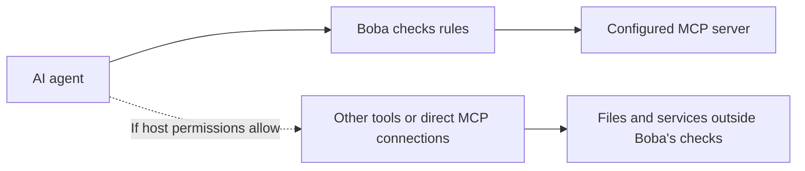
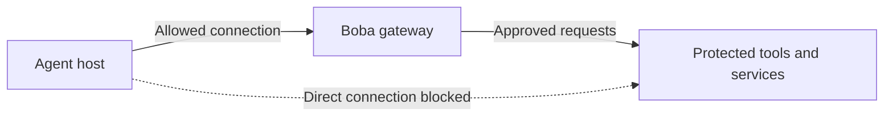
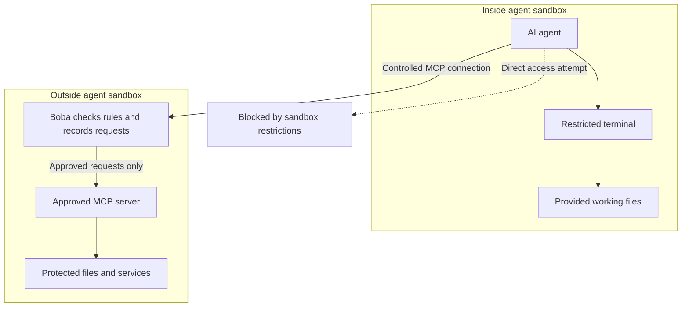
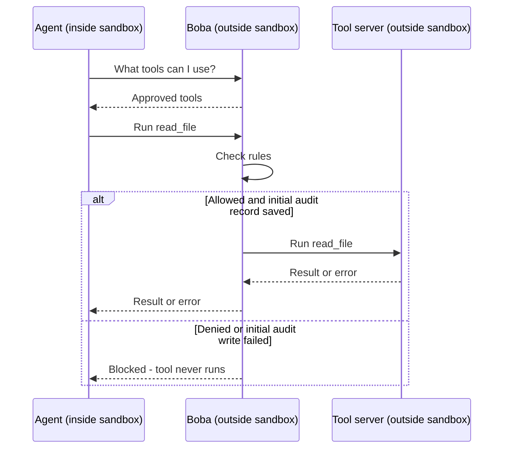

# Decision point: Boba architecture

## The gap

Boba currently checks requests sent through it to one local MCP server. It does
not control everything the agent can do.

An agent with other tools could go around Boba by:

- Reading protected files through its own file or terminal tools.
- Connecting directly to another MCP server or service.
- Using credentials available in its environment.
- Changing Boba's rules or connection settings if those files are writable.

**The gap: Boba can block a request, but it cannot currently force the agent to
send that request through Boba.** Which bypasses are possible depends on the
agent's host permissions and configuration.

### Today: another door may be open

The agent may already have these other tools, or may be able to set them up using
its terminal. Boba does not see requests sent through those other connections.

## Architecture options

| Option | Why choose it? | Gap remaining |
| --- | --- | --- |
| 1. Optional Boba checkpoint | Simple setup for protecting selected tool calls; closest to today. | Other agent tools can bypass Boba. |
| 2. One gateway for all MCP servers | Centralizes MCP policies, connections, and audit logs. | Direct terminal, file, or network access can still bypass it. |
| 3. Sandboxed agent, Boba outside | Restricts the agent's access and makes Boba the required route to protected tools. | Approved MCP servers still need their own access restrictions. |
| 4. Sandboxed agent and separately sandboxed servers | Also limits damage from buggy or malicious approved tools. | More setup and maintenance; allowed responses still need careful handling. |
| 5. Shared Boba service | Gives multiple agents or users central policies and logs. | Requires authentication, per-user permissions, and reliable hosting; agent restrictions are still needed. |
| 6. Network-enforced gateway | Makes Boba the required network route to selected protected remote resources. | Local file, process, and credential access on the agent host remains outside this boundary. |

These options can be combined. For example, a sandboxed agent can use one gateway
that routes to several separately sandboxed MCP servers.

## Selected first milestone: network-enforced gateway

**Start with option 6: enforce network access through Boba.** No agent sandbox,
container, or VM provisioning is part of this milestone. The agent remains in its
existing environment, with an independently managed network control denying direct
access to the selected protected remote resources.

Boba runs on a separate gateway host. Its existing local stdio connection to one
MCP server can remain on that host. An initial MCP-over-SSH client adapter and
dedicated server configuration are now provided in the
[deployment guide](../deploy/milestone-one/README.md). Gateway deployment,
authentication enforcement, and external network rules still require verification.
Local files, processes, and credentials on the agent machine are outside the
network boundary. See the [Milestone One plan](../milestoneOne.md) for acceptance
criteria, assumptions, and deliverables.

## Alternative for future consideration: agent sandbox

Option 3 would put the agent in a sandbox and keep Boba outside it. The following
diagrams describe that alternative, which is not selected for Milestone One.

The agent can work on files explicitly provided to it. Protected operations must
go through Boba. MCP servers can later run in their own separate sandboxes.

The blocked path represents restrictions we must configure and verify—not
something a container provides automatically. Boba and the MCP server are started
outside the agent's container, so they are not inside its sandbox.

### How the agent connects to tools

**Boba acts as an MCP server to the agent, and as an MCP client to the tool server.**
The agent needs only the connection to Boba.

The connection across the sandbox boundary still needs to be implemented.
These diagrams show the proposed architecture, not the current demo.

### What the sandbox alternative would add

- **Closes side doors:** restrict file, process, and network access that could
  bypass Boba.
- **Protects the rules:** the agent cannot edit Boba's policies or configuration.
- **Protects credentials:** service credentials stay outside the agent's environment
  and are supplied only to the components that need them.
- **Preserves useful tools:** the agent can still use a terminal within its limited
  workspace.
- **Starts small:** prove the boundary with one agent and one MCP server before
  adding multi-server routing or shared hosting.

### What the sandbox alternative would need to enforce

- Give the agent access only to approved working files, not Boba's configuration,
  credentials, or protected host files.
- Restrict network access so protected services cannot be reached directly.
- Prevent the agent from changing its restrictions or controlling the host through
  privileged interfaces such as the Docker socket.
- Provide a controlled connection to Boba across the sandbox boundary.
- Restrict MCP server permissions too; being outside the agent's sandbox does not
  mean a server should have unrestricted access.

**A container alone is not enough. Its mounts, permissions, and network rules
must enforce these limits.**

## Decision status and next step

**Selected as the first milestone; implementation started, deployment verification pending.**
Boba currently provides one local stdio connection; it does not create an agent
sandbox or enforce the proposed network boundary.

The [Milestone One plan](../milestoneOne.md) defines the scope, simple architecture
diagram, deliverables, and acceptance criteria. Build a proof of concept with one
agent host, a separate Boba gateway host, one MCP server, and independently managed
network controls. Verify that approved requests succeed through Boba while direct
network access to selected protected tools and services fails. Agent-side
sandboxes, containers, and local filesystem isolation are outside this milestone.

This addresses the selected network bypasses. It does not protect local files or
credentials on the agent host, add response inspection, prevent
every harmful allowed operation, or make audit logs tamper-proof. See the
[threat model](threat-model.md) for the existing limitations.
