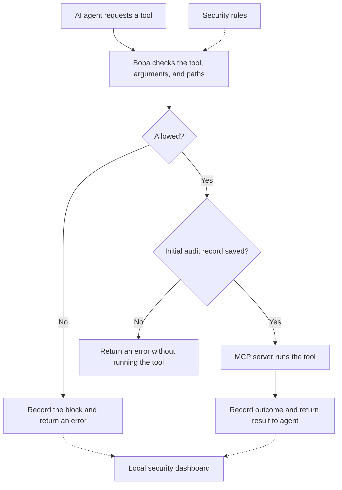

# How Boba works

Boba sits between an AI agent and one local MCP tool server. It checks requests
before tools run, records what happened, and shows the results in a dashboard.

## Request flow

1. **Request:** the agent asks to use a tool, such as `read_file`.
2. **Check:** Boba validates the tool, its arguments, and any configured file paths.
   It also counts attempts to detect excessive usage.
3. **Decide:** a blocked request never reaches the tool server. An allowed request
   proceeds only after Boba saves its initial audit record.
4. **Execute:** the tool server handles the approved request.
5. **Record:** Boba records the execution outcome and returns the result or error.
   The dashboard reads saved events from SQLite.

## Rules

The included policy lives in [`config/policies.yaml`](../config/policies.yaml).

| Rule | What Boba does |
| --- | --- |
| Default deny | Blocks tools unless explicitly approved. |
| Approved tools | Permits `read_file` and `list_directory`, subject to all other checks. |
| Approved folder | Restricts configured file paths to `demo/safe_files/`; blocks traversal and symlinks escaping that folder. |
| Valid arguments | Rejects requests that do not match the tool's input schema. |
| Protected credentials (`SEC-001`) | Blocks `.aws`, `.ssh`, `.env*`, and `secrets` paths. Built-in protections remain even if this policy rule is removed. |
| Dangerous commands (`SEC-002`) | Blocks `execute_command`, `run_shell`, and `shell_exec`. Shell execution tools are also disabled in v0.1. |
| Excessive usage (`SEC-003`) | Raises an alert after more than 30 attempts in 60 seconds, including denied attempts. An alert alone does not block a call. |
| Audit required | Does not execute a request if its initial audit record cannot be saved. |

**A block always wins. An alert never grants permission.** Restart Boba after
changing policies. Invalid configuration prevents startup.

## Example requests

| Request | Result |
| --- | --- |
| Read `hello.txt` inside the approved folder | Allowed, provided validation and audit storage succeed. |
| Read `.aws/credentials` | Blocked: protected credentials. |
| Read a path outside the approved folder | Blocked: outside the allowed boundary. |
| Run `execute_command` | Blocked: command tool is prohibited. |
| Repeatedly read an approved file beyond the threshold | Allowed with a frequency alert, provided other checks pass. |

## What you see afterward

The dashboard shows allowed and blocked requests, reasons, alerts, and execution
outcomes. Audit records omit raw arguments, file contents, and tool responses.
**Allowed means permission was granted—not that execution succeeded.**

Boba only checks requests routed through it; it does not sandbox the tool server
or inspect tool responses in v0.1. See the [threat model](threat-model.md) for details.
