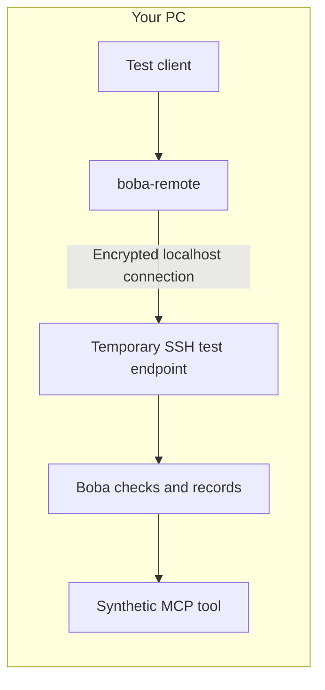

# Milestone One: start on one local device

The first stage runs entirely on the current PC. It exercises a real encrypted
SSH connection over loopback, the `boba-remote` client, Boba's policy engine and
audit log, and a synthetic MCP tool. No second computer, container, cloud account,
Windows SSH service, or firewall change is required.



## Run the local stage

From the repository root, using the prepared Windows environment:

```powershell
.\.venv\Scripts\python.exe -m pytest tests/test_remote_local.py -v
```

For a fresh environment, install the project with `pip install -e '.[dev,local-test]'`
and ensure the OpenSSH client (`ssh`) is on PATH. Linux/macOS can run the same test
file using their Python environment. The synthetic tool avoids the POSIX-only
filesystem demo so these connection checks work on Windows.

The tests start an AsyncSSH test endpoint on `127.0.0.1` with an automatically
assigned port and freshly generated keys. They launch the real OpenSSH client and
Boba subprocesses. Temporary test key permissions are restricted to the current
user. The listener and subprocesses are stopped at test completion; pytest may
retain temporary files for debugging. Keys are test-only and must not be reused.

## What is checked

- Valid client key and pinned host key: MCP initialization, tool discovery, and
  an approved tool call succeed through `boba-remote`.
- Unknown tools and malformed arguments: Boba denies execution. A downstream
  counter proves neither denied request reaches the tool handler.
- SQLite records both blocked requests and the successful execution.
- Wrong client key and wrong pinned host key: OpenSSH rejects the connection
  before Boba starts. Tests check the reason, not just an unsuccessful exit code.
- An arbitrary command is rejected and does not start Boba.
- TCP forwarding is refused by the test endpoint.

This uses an automated protocol client, not a running AI model. It requires no
model API key and does not change your AI application's configured tools.

## Boundary of this stage

The AsyncSSH fixture is test infrastructure, not the deployable OpenSSH daemon.
Passing these tests does not validate the Linux daemon configuration or establish
firewall isolation. All processes run as the same local user, so a local agent
could still access resources through its ordinary OS permissions.

The next stage selects a separately protected service and a network enforcement
point, then runs the [deployment acceptance checks](../deploy/milestone-one/README.md).
Milestone One is complete only after that network boundary is verified.
