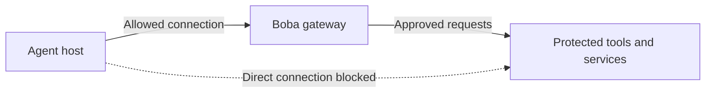

# Milestone One: Make Boba the required network route

Status: implementation started; deployment and network verification are pending.

Current starting point: **one local device**, as requested. The
[single-device guide](docs/milestone-one-local.md) runs real loopback SSH, MCP,
policy, and audit tests on the current PC. This is the first stage; the network
topology below remains the later firewall acceptance target.

## Implementation progress

- Added `boba-remote`, a client adapter carrying MCP stdio over OpenSSH with pinned
  gateway host keys and explicit client-key authentication.
- Added a dedicated gateway SSH configuration, fixed-command launcher, and
  service definition. Shells, subsystems, and forwarding are restricted; the
  launcher permits one active Boba session.
- Added a provider-neutral firewall rule template and deployment acceptance guide.
- Local client and existing policy/audit tests have passed. The gateway daemon,
  real authentication failures, and network restrictions still need deployment
  verification on the selected hosts. This milestone is not complete.

See [the implementation and deployment guide](deploy/milestone-one/README.md).

## Goal

Use network controls to require one agent host to reach protected remote tools
and services through Boba. Prove that approved requests succeed through Boba and
that direct network access to those resources fails.

No agent sandbox, container, VM provisioning, or local filesystem isolation is
part of this milestone. The agent runs in its existing environment. This milestone
addresses network bypasses to explicitly identified remote resources; it does not
restrict everything the agent can do on its own machine.

## Architecture

Boba runs on a separate gateway host. An independently managed firewall or cloud
network policy enforces the allowed paths. The agent cannot manage that control.
Results return through Boba. The dotted arrow represents a denied attempt.

One MCP server can remain local to the gateway host using Boba's existing stdio
connection. Any protected remote service it uses accepts traffic only from the
approved gateway/tool-server context. The agent has no direct network route into
the MCP server or gateway management interfaces.

## Scope

- One agent host, one gateway host, and one administrator-selected MCP server.
- External network enforcement: a firewall, routed network ACL, cloud security
  rules, or equivalent controls selected for the deployment.
- A protected test service with synthetic data and fake credentials.
- An encrypted, authenticated connection from the agent to Boba.
- Explicitly documented model-provider and other required connectivity.
- Repeatable configuration and tests for normal operation, restarts, and failures.

A Linux gateway is the initial reference target because the included demo requires
POSIX. Agent-side operating system support depends on the selected network MCP
client. Existing hosts may be used; specialized hardware is not required.

## Network policy

| Path | Policy |
| --- | --- |
| Agent host to Boba endpoint | Allow only the configured gateway endpoint and port. |
| Agent host to protected tools/services directly | Deny across every configured address and network interface. |
| Gateway/tool server to protected test service | Allow only required destinations and ports. |
| Agent host to gateway administration, file sharing, or network-policy management | Deny; do not give the agent network administration credentials. |
| Agent host to required model services | Allow documented destinations separately from MCP traffic. |
| Boba endpoint to arbitrary destinations or commands | Do not provide a general-purpose tunnel, proxy, or remote shell. |

Apply restrictions at the protected destination as well as along the agent's
network path where supported. Account for IPv4 and IPv6, alternate interfaces,
VPN routes, proxies, and any existing access path to each protected resource.
If the agent is deployed in a cloud, document metadata access and service-account
permissions separately; ordinary network rules may have exceptions for these.

The goal is to block direct access to the protected resource set. This is not a
claim of complete internet egress control or prevention of all data exfiltration.

## Connection work

Boba's core server accepts stdio. The selected milestone transport carries those
messages over a dedicated OpenSSH endpoint on TCP 2222. The agent-side
`boba-remote` adapter uses the standard MCP subprocess interface; a fixed command
on the gateway starts Boba. This adds no Streamable HTTP listener.

Deploy and verify this endpoint with pinned host keys, single-client public-key
authentication, one active Boba session, disabled forwarding, and no direct-access
fallback. Existing Boba request checks and the durable initial audit requirement
remain on the execution path.

The transport and authentication design is recorded in the deployment guide.
Keep downstream credentials on the gateway/tool-server side; do not distribute
them to the agent. Multi-user identity and user-delegated authorization remain
outside scope. Source-address filtering alone is not application authentication.

## Implementation steps

1. **Map the protected resources.** Record the two hosts, resource addresses,
   ports, interfaces, administration paths, and required model connectivity.
2. **Select the network enforcement point.** Use a control managed outside the
   agent host. Record who can change its policy and how configuration is restored.
3. **Provide the Boba network connection.** Implement or integrate the authenticated
   endpoint, retaining local stdio between Boba and its MCP server where practical.
4. **Apply the rules.** Permit the approved gateway path and deny direct protected
   access. Keep gateway management and downstream credentials off the agent host.
5. **Verify and automate.** Run the acceptance checks from the actual agent host,
   record independent network evidence, and repeat after restarts and failures.

## Acceptance criteria

All checks must pass on the documented reference topology.

| Check | Expected evidence |
| --- | --- |
| Approved request | A permitted call through Boba returns the expected result and records its execution outcome. |
| Policy-denied request | Boba returns an error; an execution counter or equivalent evidence proves the tool did not execute. |
| Direct service access | The same protected service is unreachable directly from the agent host but independently confirmed healthy and reachable from the permitted gateway/tool-server context. |
| Direct tool-server access | The agent host cannot connect to a downstream MCP endpoint or obtain access through gateway remote-shell or file-sharing services. |
| Alternate network paths | Direct attempts using applicable IPv4/IPv6 addresses, interfaces, routes, and configured proxies fail for the protected resource set. |
| Agent terminal | Direct protected-service requests from the agent's terminal and its child processes are denied by the same network controls. |
| Gateway authentication | A caller with missing or invalid gateway credentials cannot invoke tools, even from an otherwise permitted network source. |
| Administration | The agent host cannot reach policy-management interfaces or use provisioned credentials to change network rules. |
| Credential placement | Deployment inspection confirms downstream credentials are absent from the agent configuration and environment; this is a deployment check, not local secret isolation. |
| Restart | Required rules are active before service is exposed, and the checks pass again after restarting the gateway and agent host. |
| Boba unavailable | New protected operations fail when Boba stops; direct access stays denied. Already-started operations are not assumed to be undone. |
| Initial audit failure | If Boba cannot save its initial audit record, the tool does not execute. |

Boba logs only traffic it receives. Use firewall logs, connection tests, and
server-side counters as evidence for direct bypass attempts. Use only synthetic
resources and credentials, and keep payloads and credentials out of reports.

## Deliverables and completion

- Versioned network rules and a documented reference topology.
- A working authenticated MCP network connection to Boba.
- Startup, shutdown, and verification instructions.
- An automated acceptance suite and recorded evidence for every criterion.
- An updated threat model that separates network protection from local access.

Completion requires reproducible deployment and passing checks, not merely an
allowed connection to Boba. No enforcement is claimed until these checks pass.

## Assumptions and limitations

The agent has no network-policy administration privileges or alternative identity
that can reach the protected resources. Network controls are administered outside
its machine. Enumerating and verifying alternate paths is part of implementation.

Network rules do not stop the agent reading local files, inspecting locally
available credentials, changing local configuration, or running commands allowed
by its existing OS permissions. Copies of protected data already on the agent
host are outside this boundary. The milestone adds no host-isolation guarantee.

Containers, sandboxes, host permission hardening, shared multi-user hosting,
multiple MCP servers, user-delegated authorization, templates, approvals, response
inspection/sanitization, A2A, SIEM export, and tamper-proof storage are outside scope.
Allowed operations can still be harmful; a timeout does not prove no action ran.

## Planning estimate

Re-estimate after selecting the network enforcement platform and authenticated
MCP transport. The earlier 1-2 week proof-of-concept estimate was preliminary;
network endpoint development and infrastructure access can change it materially.

## Related documents

- [Architecture decision point](docs/architecture-decision-point.md)
- [Current implementation architecture](docs/architecture.md)
- [Current threat model](docs/threat-model.md)
- [Proposed gateway capabilities](docs/mcp-gateway-understanding.md)
